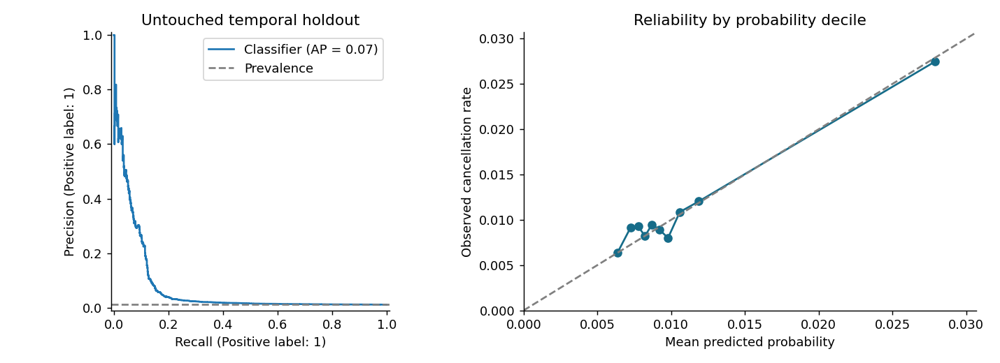

# Rider Cancellation Risk Prediction

A complete, reproducible data science portfolio project built from the supplied
450,000-row training set and 144,844-row unlabeled test set. It predicts cancellation
risk immediately after allocation and evaluates performance on later orders.

**Start with [the executed notebook](Rider_Cancellation.ipynb)** or the browser-readable
`reports/notebook.html`. Read [the findings](reports/findings.md) for measured results,
operating assumptions, limitations, and charts.

## Measured results

Four candidates were compared on a forward validation window. **Logistic regression**
won; the gradient-boosting candidates did not improve validation average precision.
On the untouched February 4–6 holdout of 93,903 orders:

| Measure | Result |
|---|---:|
| Cancellation prevalence / no-skill AP | 1.10% |
| Average precision | 0.0722 |
| ROC AUC | 0.6066 |
| Top 5% queue: cancellation recall | 18.72% |
| Top 5% queue: precision | 4.11% |
| Top 5% queue: lift over prevalence | 3.74× |
| Validation-selected threshold: precision / recall | 22.95% / 10.86% |

There is useful ranking signal and substantial remaining error. These are retrospective
results for the frozen evaluation model, not an independently measured score for the
final refit model or the unlabeled test set. Cancellation initiator is unknown.



## What the project includes

- Problem framing, prediction-time contract, data dictionary, and model card.
- EDA: imbalance, missingness, daily rates, allocation-delay and distance cohorts.
- Data validation, exact deduplication, temporal splits, and label-resolution purging.
- Explicit feature allowlist excluding downstream events and ambiguous aggregate snapshots.
- Prior baseline, logistic regression, and two gradient-boosting configurations.
- Validation-only selection and thresholding; AP, ROC AUC, Brier score, log loss,
  confusion counts, queue metrics, and daily holdout metrics.
- Permutation importance, calibration diagnostics, feature drift, and illustrative cost sensitivity.
- Saved evaluation/refit pipelines, batch inference, test probabilities, and a binary submission.
- Executed notebook, browser-readable report, seven contract tests, and CI configuration.
- Source fingerprints, runtime versions, and reproducible command-line entry points.

## Run locally

From this project directory in PowerShell, create an environment and install:

```powershell
python -m venv .venv
.\.venv\Scripts\Activate.ps1
python -m pip install -r requirements-lock.txt
python -m pip install -e ".[dev]"
python -m pytest -q
python -m rider_cancellation.train
```

`requirements-lock.txt` pins the runtime used for the delivered artifacts. The tested
Python version is 3.13.9; the project supports Python 3.11 or later subject to dependencies.
Training uses all supplied labeled rows, with four CPU threads, and prints progress.
No external service, credentials, or GPU is required.

Tests use `.pytest_tmp/` inside the project to avoid Windows user-temp permission
issues. This Git-ignored folder is disposable and is cleared by pytest each run;
do not store project files there. Run tests from this project directory.

The delivered local folder already contains `data/raw/train.csv`, `test.csv`, and
`sample_submission.csv`. A source-only archive excludes raw data and model/prediction
artifacts. If starting from that archive, copy your three CSVs into `data/raw/`, then train.

To write a new experimental run to a separate folder:

```powershell
python -m rider_cancellation.train --data-dir data/raw --output-dir runs/experiment_01 --false-negative-cost 10 --false-positive-cost 1
```

The default costs are illustrative. They do not represent actual company economics.
The threshold is chosen on validation under these assumptions; cost sensitivity is reported.

Score new orders with the bundled refit model:

```powershell
python -m rider_cancellation.predict --model models/model.joblib --input data/raw/test.csv --output predictions/scored_orders.csv
```

Required scoring fields: `order_id`, `order_time`, `allot_time`, `first_mile_distance`,
and `last_mile_distance`. Outputs preserve input order and contain order ID,
cancellation probability, and a thresholded `cancelled` decision. Load only trusted
joblib artifacts. A single-row example is in `examples/order.csv`.

Open the notebook in Jupyter or VS Code. It reads the raw data and saved results,
explains the experiment, and demonstrates inference. Its optional retraining cell
is disabled by default because the delivered results are already generated.

## Project layout

```text
Rider_Cancellation.ipynb       Executed project narrative and analysis
src/rider_cancellation/        Features, checks, splitting, training, scoring
tests/                        Seven behavioral contract tests
data/raw/                     User-provided CSVs; excluded from Git
models/evaluation_model.joblib Frozen model used for holdout results
models/model.joblib            Final refit for batch scoring
predictions/                   Holdout predictions, test probabilities, submission
reports/findings.md             Results and interpretation
reports/notebook.html           Browser-readable executed notebook
reports/figures/                Six experiment plots plus cohort EDA
reports/*.json, *.csv           Audit, metrics, drift, costs, provenance
DATA_DICTIONARY.md              Field definitions and exclusions
MODEL_CARD.md                   Use conditions and limitations
```

## Design and limits

The supplied data is ordered across time. Whole allocation dates separate training,
validation, and holdout; outcomes unresolved at a boundary are removed from the earlier
window. Imputation/scaling are fitted on training only. All class imbalance is retained;
accuracy is not used for model selection. No target-derived features enter the pipeline.

Distances and the allocation event must be available at prediction time. Verify that
`allot_time` means the intended allocation rather than a retrospective final reassignment.
The four documented feature inputs are the only raw fields consulted by the model.
Counters and session/reassignment fields remain excluded until their snapshot timing
is established. This conservative scope can sacrifice performance to preserve validity.

Temporal weekday PSI is naturally large when comparing only a few different days;
it is a calendar-composition difference, not proof of behavioral drift. Permutation
importance is associative and affected by correlated features. Predicted probabilities
are diagnosed for reliability but have not been separately recalibrated.

The final refit uses only labels resolved before the earliest test allocation, retaining
the validation threshold. It is not the frozen evaluation model. The supplied submission
template contains binary values, so `submission.csv` uses binary decisions; competition
scoring rules were not supplied. `test_probabilities.csv` also preserves continuous scores.

Before real use: verify upstream field semantics, collect a longer period, run rolling
backtests and rider-cohort checks, estimate review capacity and intervention effects,
then conduct a monitored prospective experiment. No realized savings, cancellation
causality, or fairness guarantee is claimed. Scores should not drive rider penalties.

The original source folder was preserved. Dataset license and original collection
provenance were not provided; review permission before publishing the data. Generated
code has no assigned open-source license; choose one before publishing a public repo.
