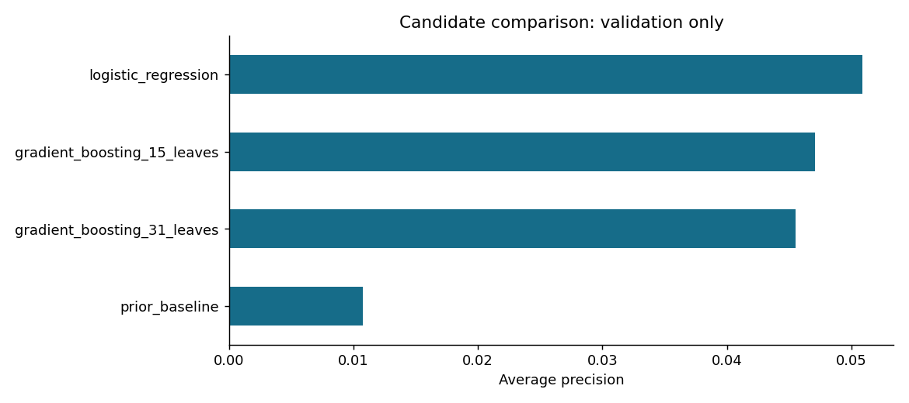
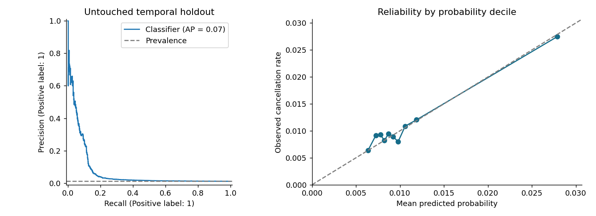
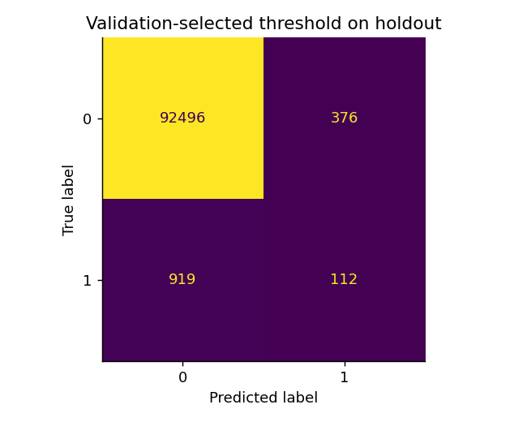
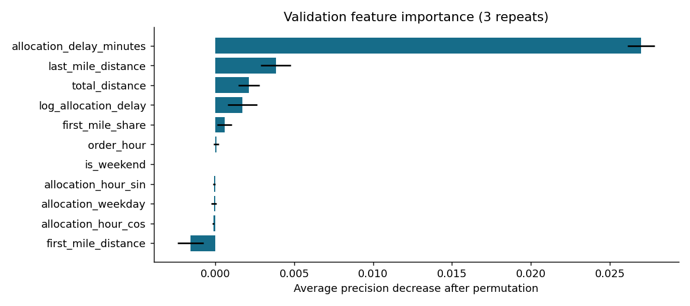
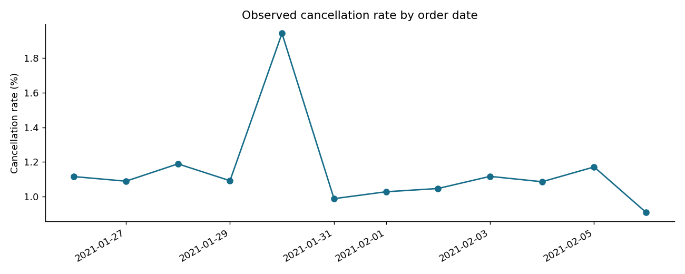
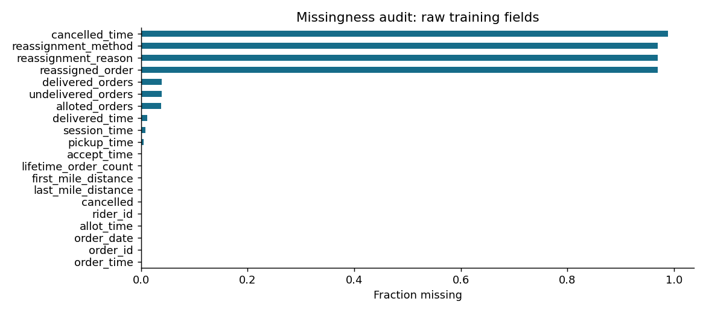

# Rider cancellation: experimental findings

## Decision and prediction contract
Rank orders for optional human review immediately after allocation. Predict the supplied
`cancelled` label; the data does not establish who initiated cancellation or its cause.
This is a retrospective portfolio study, not evidence that an intervention prevents cancellation.
Distances are assumed to be available when the allocation event occurs; verify this upstream.

## Data and evaluation
- Raw training rows: 450,000; test rows: 144,844.
- Exact duplicates removed: 1; outcomes already known at allocation removed: 7.
- Eligible cancellation prevalence: 1.158%.
- Forward validation starts 2021-02-02 00:00:00; untouched holdout starts 2021-02-04 00:00:00.
- Training/validation labels crossing the next boundary were purged: 34/13.
- Fit preprocessing on training only. Select among four candidates by validation average precision.
- Select the decision threshold on validation only; freeze it before holdout evaluation.

## Measured holdout results
Selected model: **logistic_regression**.

| Metric | Selected model | Prior-only baseline |
|---|---:|---:|
| Average precision | 0.07219 | 0.01098 |
| ROC AUC | 0.6066 | 0.5000 |
| Brier score (lower is better) | 0.010511 | 0.010860 |
| Log loss (lower is better) | 0.057271 | 0.060501 |

At threshold **0.059893**, precision is **22.95%**,
recall **10.86%**, F1 **0.1475**, and alert rate **0.52%**.
The highest-risk 5% captures **18.72%** of cancellations
with **4.11%** precision (**3.74x** prevalence).
Confusion counts: TP 112, FP 376, FN 919, TN 92,496.
The 5% queue is a ranking diagnostic with deterministic tie breaking, not a promised operating capacity.

## Illustrative operating costs
The default scenario assigns a missed cancellation 10 cost units and
a false alert 1. These values are assumptions, not measured business costs.
Holdout classification loss is 9,566 units, compared with 10,310
for flagging no orders. This loss is **not realized savings or ROI**: review cost for true alerts,
intervention effectiveness, and adverse effects are not modeled.
See `validation_cost_sensitivity.csv` for alternative assumptions chosen exclusively on validation.

## Interpretation and drift
The strongest validation permutation signals include
allocation_delay_minutes, last_mile_distance, total_distance.
Permutation importance is predictive association; correlated engineered features share signal.
The largest train-to-test feature PSI is 4.982 for `allocation_weekday`.
PSI describes binned distribution differences and is not a statistical significance test.
No calibration mapping was fitted; inspect the reliability plot and Brier/log-loss metrics
before treating raw scores as decision-grade probabilities.

## Leakage controls and limitations
The feature allowlist uses order/allocation times and first/last-mile distances only.
`pickup_time`, `delivered_time`, and `cancelled_time` are outcomes and excluded from features.
`accept_time` and reassignment fields may occur after first allocation and are excluded.
Counters, session time, and lifetime counts have undocumented snapshot timing and are excluded.
Outcome timestamps are used only for eligibility and boundary purging. IDs are used only for joins.
There is no location, weather, traffic, capacity, intervention, demographic, or cost ground truth.
The observation window is short; riders may repeat across periods. This evaluates later orders
in the same service, not generalization to unseen riders, cities, seasons, or years.
The supplied labels describe order cancellation, not proven rider misconduct.
Do not use the score alone for rider penalties or employment decisions.

## Artifacts and next steps
`models/evaluation_model.joblib` preserves the model used for the holdout numbers.
`models/model.joblib` refits the selected architecture on 449,258
labels resolved before 2021-02-06 10:03:27, retaining the validation threshold.
The refit model has no separate labeled evaluation; holdout results describe the frozen evaluation model.
`submission.csv` follows the binary-valued supplied template. The actual competition scoring rule
was not supplied; use `test_probabilities.csv` if the scoring system expects probabilities.
Test labels are unavailable, so there is no measured test-set score.

Before deployment, verify feature timestamps and distance units, expand the time window,
run rolling temporal backtests and rider-cohort checks, recalibrate with a separate recent window,
agree on review capacity and costs, then run a prospective monitored experiment.
Monitor schema failures, missingness, score distributions, queue volume, delayed-label AP,
precision/recall, calibration, and operational outcomes with an explicit rollback owner.

Run environment: {"python": "3.13.9", "pandas": "2.3.3", "numpy": "2.3.5", "scikit_learn": "1.7.2", "joblib": "1.5.2", "matplotlib": "3.10.6"}. Full provenance is in `run_manifest.json`.
